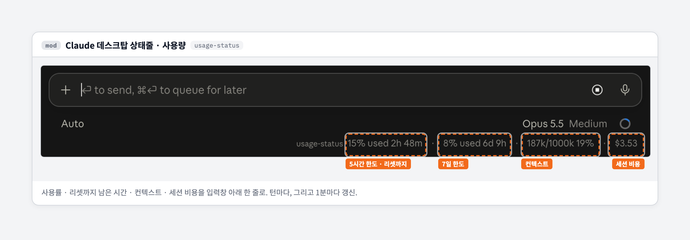

# usage-status

A Claude Code mod that keeps your usage in the status line: 5-hour and 7-day limits with time until reset, context fill, and session cost.
Works in the Claude desktop app's Code tab and in the terminal.



```
15% used 2h 48m · 8% used 6d 9h · 187k/1M 19% · $3.53
```

| Item | Shows |
| --- | --- |
| 5-hour limit | Usage and time until reset |
| 7-day limit | Usage and time until reset |
| Context | Tokens used / window size and percent |
| Session cost | Tokens used so far, priced at API rates |

- Updates at session start, at the end of every turn, and every minute (on the minute boundary)
- Shows a toast once when the 5-hour or 7-day limit passes 80% and 95%
- Limits appear only on subscription (Pro / Max) accounts

## Install

Run `claude` in a terminal, then

```
/plugin install usage-status --marketplace sijunnoh/claude-usage-status
```

Install at user scope and it turns on in every new session.
The command isn't available in the desktop app's Code tab, but once installed from a terminal, the mod shows up in the desktop app too.

## Development

```bash
claude plugin validate .
claude plugin test .
```

Built against Claude Code 2.1.295. The mod API is new and may change.

## Blog post (Korean)

[Claude mod가 나와서 만든 첫 플러그인, usage-status](https://blog.mech2cs.com/posts/claude-code-mod-usage-status)

## License

MIT
